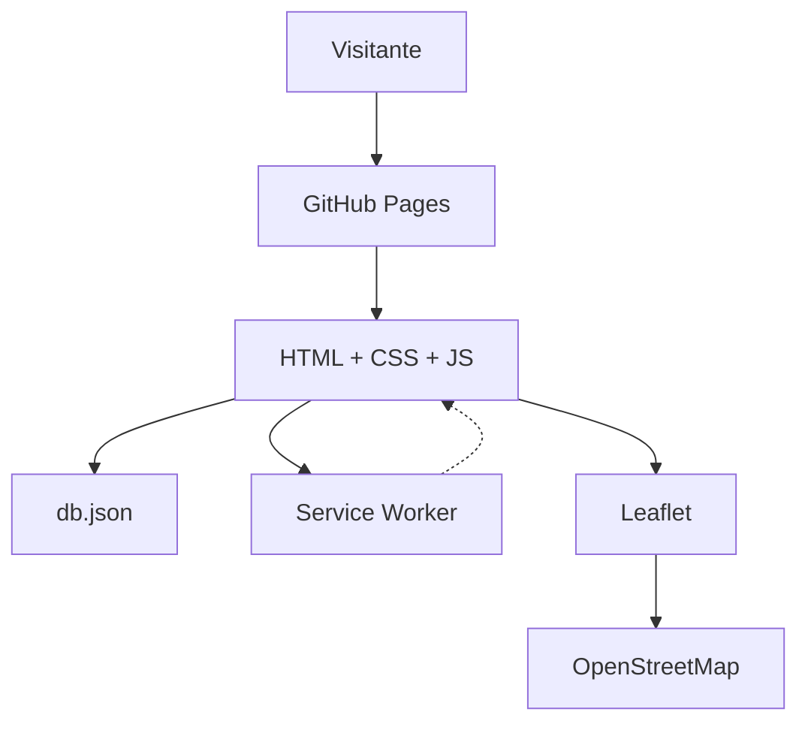
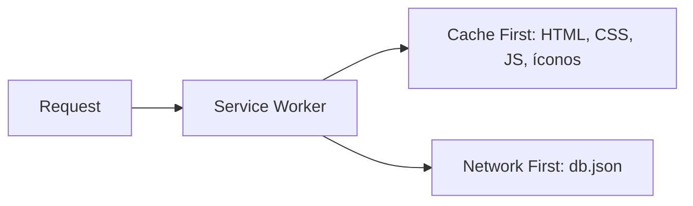

# Farmacias de Balcarce

<div align="center">  </div>

> PWA estática con el directorio de farmacias de Balcarce, Buenos Aires: dirección, teléfono y mapa de cada una. Sin backend, sin dependencias.

[](https://balcarce.remedi.ar/)
[](https://creativecommons.org/licenses/by-nc/4.0/)
[](https://web.dev/progressive-web-apps/)
[](https://github.com/psbella/farmcias-balcarce)
[](https://leafletjs.com/)
[](https://pages.github.com/)

**→ [balcarce.remedi.ar](https://balcarce.remedi.ar)**

---

## Tabla de contenidos

- [Descripción](#descripción)
- [Arquitectura del sistema](#arquitectura-del-sistema)
- [Estructura del proyecto](#estructura-del-proyecto)
- [Stack tecnológico](#stack-tecnológico)
- [Modelo de datos](#modelo-de-datos)
- [Estrategia de caché (PWA)](#estrategia-de-caché-pwa)
- [Tests](#tests)
- [Panel de administración](#panel-de-administración)
- [Instalación local](#instalación-local)
- [Proyectos relacionados](#proyectos-relacionados)
- [Licencia](#licencia)

---

## Descripción

Directorio de las farmacias de Balcarce. Cada una se muestra como una tarjeta (nombre, dirección, teléfono con enlace para llamar) y como un pin en un mapa Leaflet. Si una farmacia todavía no tiene coordenadas cargadas, no se dibuja ningún pin y al tocar la tarjeta se abre su dirección en Google Maps.

Esta versión **no informa farmacias de turno ni horarios**: es solo el directorio. Está derivada de [farmaciasmdp](https://github.com/psbella/farmaciasmdp), de donde se quitó la lógica de rotación de turnos.

La app es instalable como PWA (Android, desktop e iOS vía instrucciones propias), funciona offline gracias a un Service Worker, y está optimizada para SEO con Schema.org, Open Graph y sitemap.

---

## Arquitectura del sistema

La aplicación es **100% estática**: no existe servidor de aplicaciones. GitHub Pages sirve los archivos y toda la lógica corre en el navegador del usuario.



---

## Estructura del proyecto

```
farmcias-balcarce/
├── index.html                  # Entry point — contenido estático para SEO + bootstrap JS
├── admin-map.html              # Panel interno para cargar/corregir datos y coordenadas
├── privacidad.html             # Política de privacidad
├── terminos.html               # Términos de uso
│
├── db.json                     # Lista de farmacias
│                                #   [ { nombre, direccion, telefono, lat, lng }, ... ]
├── manifest.json               # Web App Manifest (PWA)
├── sw.js                       # Service Worker
│
├── css/                        # Estilos, un archivo por sección
│
├── js/                         # Sitio público, un módulo ES6 por responsabilidad
│   ├── main.js                 # Entry point
│   ├── config.js               # Ciudad, centro del mapa y ruta de db.json (lo único propio de la ciudad)
│   ├── data.js                 # Carga de db.json y utilidades
│   ├── maps.js                 # Mapa Leaflet, marcadores, popups
│   ├── ui.js                   # Render de tarjetas, bottom sheet mobile
│   ├── theme.js · install.js · escape.js · analytics.js
│   ├── legal-theme.js · scroll-top.js · sw-update.js
│   └── admin/                  # Panel de administración (admin-map.html)
│
├── images/                     # Íconos PWA
├── tests/                      # node:test, sin dependencias
├── sitemap.xml · robots.txt    # SEO
├── CNAME                       # → balcarce.remedi.ar
├── CHANGELOG.md
└── LICENSE                     # CC BY-NC 4.0
```

---

## Stack tecnológico

| Capa | Tecnología | Notas |
|---|---|---|
| Markup | HTML5 | Contenido estático inline para SEO; Schema.org embebido |
| Estilos | CSS3 + Custom Properties | Dark/light mode, mobile-first |
| Lógica | JavaScript ES6+ Modules | Sin frameworks, sin bundler, sin npm |
| Mapas | Leaflet 1.9.x + OpenStreetMap | Marcadores SVG personalizados |
| PWA | Service Worker + Web App Manifest | Cache API, instalable |
| Tests | `node:test` | Cero dependencias externas |
| Hosting | GitHub Pages | Deploy en cada push a `main` |

---

## Modelo de datos

`db.json` es una lista plana, una farmacia por línea:

```json
[
  { "nombre": "BENITES", "direccion": "AV. CHAVES 329 E/ 5 Y 7", "telefono": "2266420309", "lat": null, "lng": null }
]
```

- `lat` y `lng` se cargan **juntas** (ambas `null` o ambas números). Mientras sean `null` la farmacia aparece en la lista pero no en el mapa.
- Los teléfonos van como código de área + número, sin 0 ni 15 (ej. `2266420309`).
- La edición de coordenadas/datos se hace desde el [panel de administración](#panel-de-administración). Si se edita `db.json` a mano, correr `npm test` para validar el formato.
- `index.html` incluye un bloque estático con el listado (para SEO) que **no se genera solo**: si cambia `db.json`, actualizarlo a mano.

---

## Estrategia de caché (PWA)



Si cambia la lista de archivos que se precachean en `sw.js`, o cualquier archivo estático, subir el número de `CACHE_NAME` para que los visitantes reciban la versión nueva.

---

## Tests

```bash
npm test
```

Cubren las utilidades de `js/data.js`, la **integridad de `db.json`** (formato, coordenadas cerca de la ciudad, sin duplicados) y la serialización del panel de administración. Detalle en [`tests/README.md`](tests/README.md).

---

## Panel de administración

`admin-map.html` es una herramienta interna (requiere un token de GitHub) para revisar y corregir nombre, dirección, teléfono y coordenadas de cada farmacia, con mapa Leaflet, vista embebida de Google Maps y búsqueda de dirección vía Nominatim. Guarda los cambios directo en `db.json` a través de la Contents API de GitHub — no hay backend propio.

---

## Instalación local

> **Requisito**: servir con un servidor HTTP local. Los módulos ES6 y el Service Worker no funcionan con `file://`.

```bash
git clone https://github.com/psbella/farmcias-balcarce.git
cd farmcias-balcarce

# Opción A — Python (sin instalar nada)
python3 -m http.server 8080

# Opción B — Node.js
npx serve .
```

Luego abrir `http://localhost:8080` en el navegador.

---

## Proyectos relacionados

| Proyecto | Descripción |
|---|---|
| [remedi.ar](https://remedi.ar) | Buscador de precios de medicamentos en farmacias de Argentina |
| [farmaciasmdp](https://github.com/psbella/farmaciasmdp) | Farmacias de turno en Mar del Plata (proyecto base de este) |

---

## Licencia

Distribuido bajo [Creative Commons BY-NC 4.0](https://creativecommons.org/licenses/by-nc/4.0/).
Podés usar y adaptar el código con atribución, pero no con fines comerciales.
